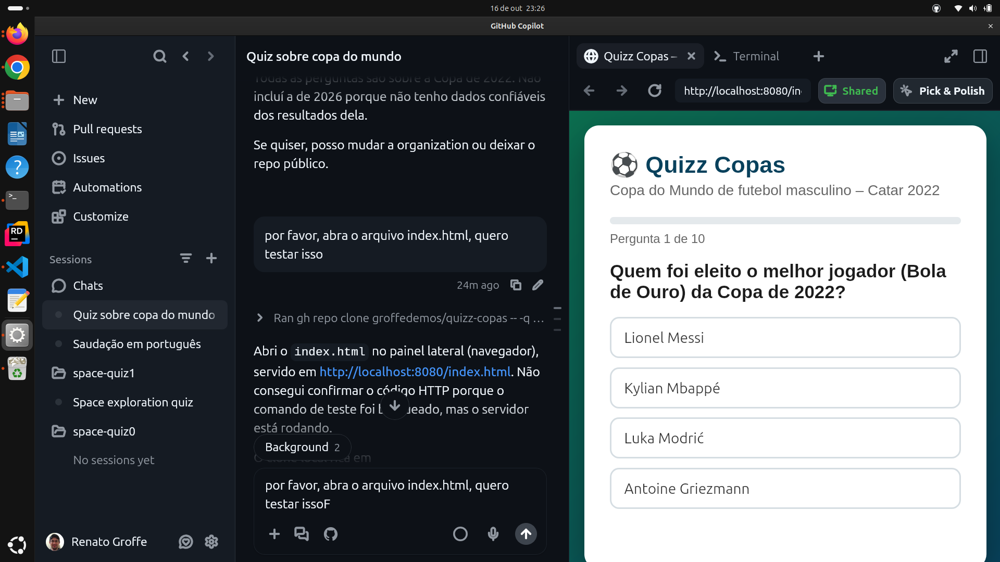
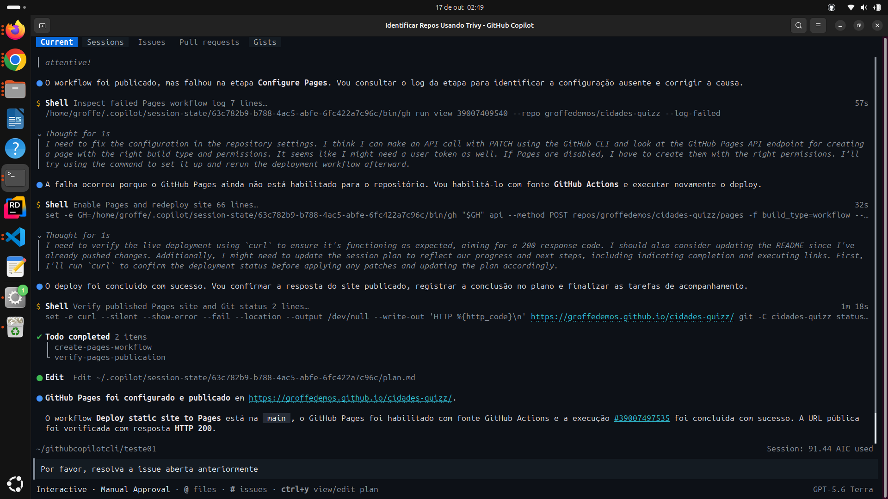

# dev-days-2026-10-taboao-sp
Conteúdos do evento "Dev Days", realizando no Taboão da Serra-SP em 17/10/2026.

## GitHub Copilot App

Configurando o GitHub Copilot App para execução em um Ubuntu x64:

```bash
chmod +x ./GitHub-Copilot-linux-x64.AppImage
```

Uma sugestão para trabalho com o GitHub Copilot App:

_Crie um repo chamado quizz-copas, com um README.md descrevendo a estrutura definida para o mesmo... Neste repo deverá existir um index.html formatado, em que serão feitas 10 perguntas sobre as Copas do Mundo de futebol masculino de 2022. Cada questão terá uma única resposta válida e no final será exibido um resultado, com a possibilidade de se fazer novamente o quizz._

Testes via GitHub Copilot App:



Um exemplo de issue que poderia ser criada, com posterior implementação:

__Abra agora uma issue para que um usuário possa alternar no site entre o modo normal criado inicialmente e o modo dark.__

E um exemplo de uso de **Plan**:

__Planeje agora como seria o deployment desta solução utilizando GitHub Pages__

## GitHub Copilot CLI

Instalando o GitHub Copilot CLI via GitHub:

```bash
npm install -g @github/copilot@prerelease
```

Uma sugestão para trabalho com o GitHub Copilot CLI:

__Por favor crie em groffedemos um repo chamado cidades-quizz, com um README.md descrevendo a estrutura definida para o mesmo... Neste repo deverá existir um index.html formatado, em que serão feitas 6 perguntas sobre capitais de países ao redor do globo. Cada questão terá uma única resposta válida e no final será exibido um resultado, com a possibilidade de se fazer novamente o quizz.__

Um exemplo de issue que poderia ser criada, com posterior implementação:

__Abra agora uma issue para que um usuário possa alternar no site entre o modo normal criado inicialmente e o modo dark.__

E um exemplo de uso de **Plan**:

__Planeje agora como seria o deployment desta solução utilizando GitHub Pages__

Algumas interações:

